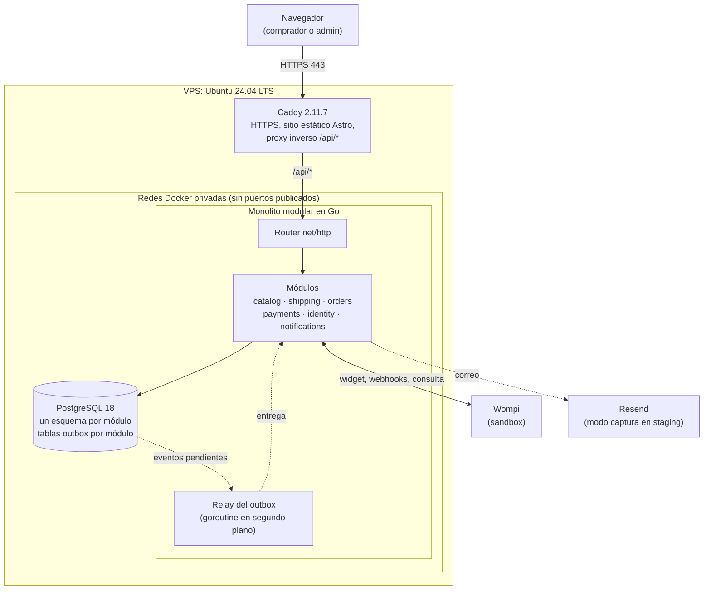
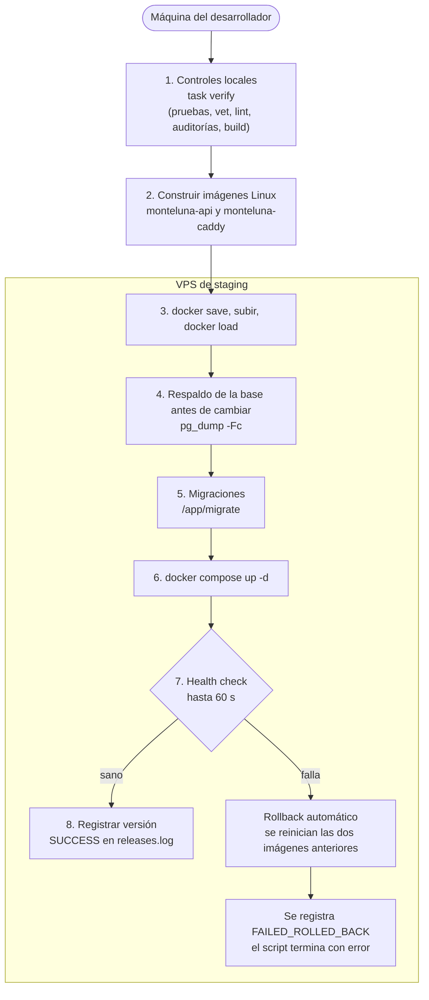
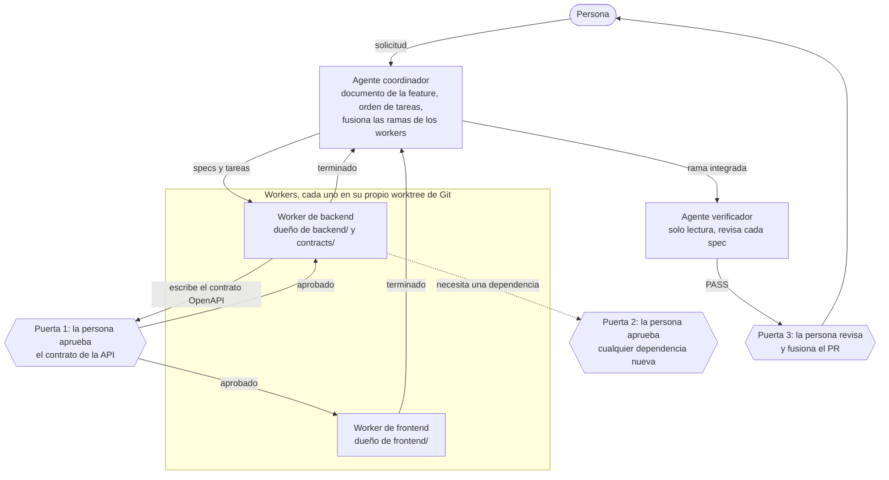
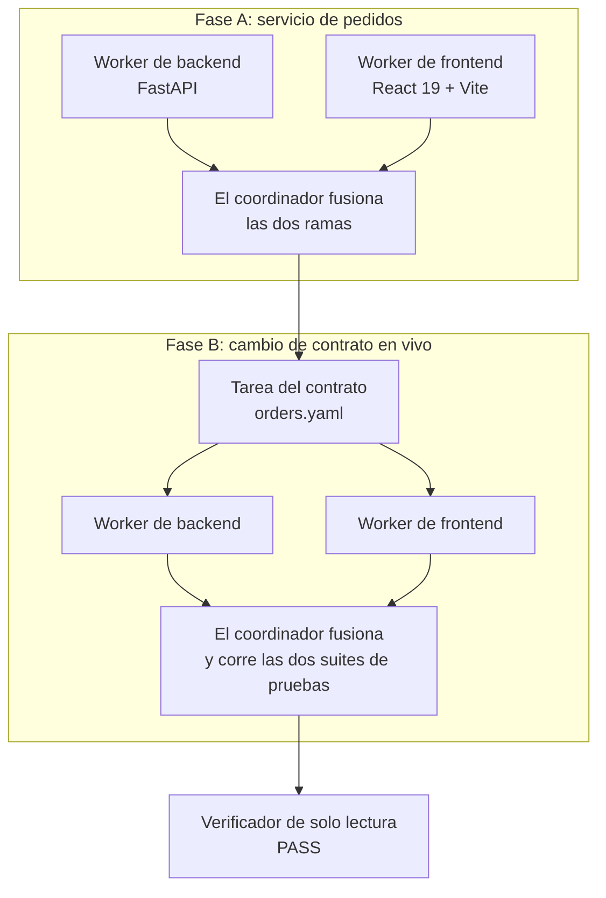
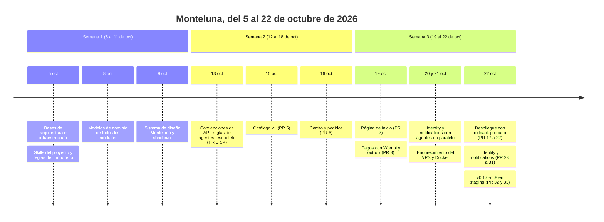
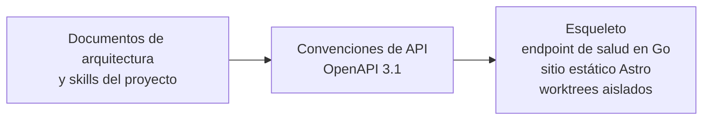
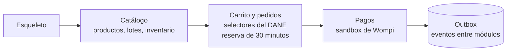
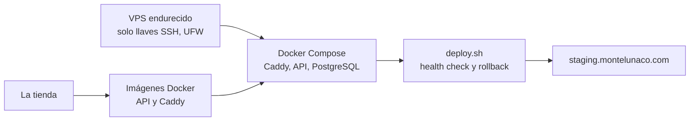
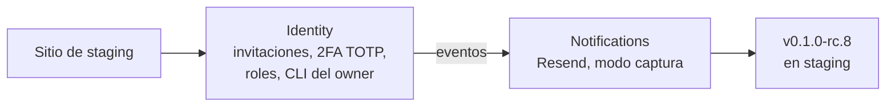

<div align="center">

[English](README.md) | [Español](README.es.md)

# Monteluna

**Una tienda ficticia de café y cacao colombianos, construida como demo educativa con agentes de IA trabajando en paralelo.**

Autor: **Willy Cruz** ([@freedomCruz](https://github.com/freedomCruz))

[](LICENSE)
[](#demo-educativa-y-aviso)
[](backend/)
[](frontend/)
[](frontend/)
[](docs/architecture/data-modeling.md)
[](deploy/caddy/)
[](deploy/compose.yaml)
[](#agentes-de-ia-trabajando-en-paralelo)
[](https://staging.montelunaco.com)

</div>

---

### Contenido

- [Demo educativa y aviso](#demo-educativa-y-aviso)
- [¿Qué es Monteluna?](#qué-es-monteluna)
- [La arquitectura, explicada para cualquiera](#la-arquitectura-explicada-para-cualquiera)
- [Despliegue y rollback automático](#despliegue-y-rollback-automático)
- [Agentes de IA trabajando en paralelo](#agentes-de-ia-trabajando-en-paralelo)
- [Piloto 3: cómo elegimos el patrón](#piloto-3-cómo-elegimos-el-patrón)
- [Lo que construimos, semana a semana](#lo-que-construimos-semana-a-semana)
- [Estructura del repositorio](#estructura-del-repositorio)
- [Cómo correrlo en local](#cómo-correrlo-en-local)
- [Estado y próximos pasos](#estado-y-próximos-pasos)
- [Licencia](#licencia)

---

## Demo educativa y aviso

> [!WARNING]
> **Monteluna es una tienda ficticia de café y cacao, construida como demo educativa para transmisiones en vivo.**
>
> - **No son productos reales:** los nombres de productos, fincas, orígenes, notas de cata, precios e inventario son datos inventados. Nada está a la venta y nunca se enviará nada.
> - **Solo pagos de prueba:** el sitio de staging ([`staging.montelunaco.com`](https://staging.montelunaco.com)) usa el **sandbox de Wompi**, así que no se mueve dinero real. Nunca ingreses números de tarjeta reales ni datos personales reales.
> - **Sin afiliación:** Monteluna no tiene relación con ninguna marca, finca ni productor reales.

---

## ¿Qué es Monteluna?

Monteluna es una tienda en línea completa que usamos en transmisiones en vivo para mostrar cómo una persona puede dirigir agentes de IA para construir una aplicación realista con disciplina de ingeniería real: contratos primero, pruebas primero, revisiones y despliegues seguros.

### Lo que ve un comprador
- **Catálogo:** página de tienda (`/tienda`), historias de origen (`/origenes/<slug>`) y páginas de producto (`/productos/<slug>`), todas generadas como HTML estático.
- **Precios e inventario frescos:** las páginas son estáticas, pero el precio, el precio de comparación, la disponibilidad y la fecha de producción (tueste) se consultan a la API desde el navegador, así que siempre están al día sin reconstruir el sitio.
- **Carrito:** un panel lateral y una página de carrito (`/carrito`).
- **Compra como invitado (`/checkout`):** selectores de departamento y municipio colombianos tomados de la lista oficial DIVIPOLA del DANE, y una cotización de envío por zona y rango de peso.
- **Pagos:** el widget Web Checkout de Wompi con firma de integridad en el servidor, webhooks firmados y consulta de respaldo (solo sandbox).
- **Seguimiento del pedido (`/pedido?token=...`):** pasos del estado del pedido, una cuenta regresiva de la reserva de inventario de 30 minutos y una copia fija de cada línea comprada.

### Lo que corre detrás
Un solo programa en Go (un *monolito modular*) con seis módulos: `catalog`, `shipping`, `orders`, `payments`, `identity` y `notifications`.
- **Contrato primero:** cada endpoint se describe primero en un archivo OpenAPI 3.1 escrito a mano en [`contracts/openapi/`](contracts/openapi/), y el código tiene que coincidir con él.
- **Cada módulo es dueño de sus datos:** un esquema de PostgreSQL por módulo, sin claves foráneas ni joins entre esquemas.
- **Efectos secundarios confiables (outbox transaccional):** cuando algo pasa en un módulo (por ejemplo, se paga un pedido), el evento se guarda en la misma transacción de base de datos que el cambio, y una rutina en segundo plano dentro del mismo programa lo entrega. No hace falta un broker de mensajes.
- **Seguridad de administradores:** invitaciones por correo, inicio de sesión con contraseña con bloqueo y límite de intentos, autenticación en dos pasos TOTP obligatoria con códigos de recuperación, roles `owner` y `staff`, eventos de seguridad auditados y un comando, solo por SSH, para crear el primer owner.
- **Correo transaccional:** correos de restablecimiento de contraseña e invitación a través de Resend, con webhooks de entrega firmados y supresión por rebote o queja. En staging, los correos solo se capturan en memoria; nunca se envían.

---

## La arquitectura, explicada para cualquiera

Piensa en Monteluna como una pequeña cafetería con oficina:

- **Caddy es la puerta de entrada.** Se encarga de la conexión segura (HTTPS), entrega por sí mismo los menús impresos (las páginas estáticas de Astro) y manda cualquier pedido o pregunta (`/api/*`) a la oficina.
- **El programa en Go es la oficina.** Seis departamentos trabajan en el mismo salón (catálogo, envíos, pedidos, pagos, identidad, notificaciones). Se comunican con formularios escritos (los contratos OpenAPI y las interfaces de Go), nunca metiéndose en el escritorio del otro.
- **PostgreSQL es el archivador.** Cada departamento tiene su propio cajón con llave (su esquema). Pedidos no puede abrir el cajón de catálogo; tiene que pedírselo al departamento de catálogo.
- **El outbox es la bandeja de "por avisar" de cada departamento.** Cuando pagos confirma un pago, archiva el recibo y deja una nota en su bandeja en el mismo movimiento. Un mensajero vacía las bandejas y avisa a los demás departamentos. Si se va la luz a la mitad, la nota y el recibo quedan guardados los dos o no queda ninguno, así que nada se pierde.



### ¿Por qué esta arquitectura?

1. **Un programa modular en lugar de microservicios.** Todo corre en un VPS pequeño (4 vCPU compartidas, 8 GB de RAM, 100 GB de SSD; consulta [`infrastructure.md`](docs/architecture/infrastructure.md)). Un solo programa significa un solo despliegue, llamadas dentro del mismo proceso y menos piezas móviles. Los módulos siguen aislados (esquema propio, comunicación por interfaces de Go y eventos), así que cualquiera podría separarse más adelante ([`system-architecture.md`](docs/architecture/system-architecture.md), sección 5).
2. **Capas hexagonales dentro de cada módulo.** `domain/` contiene las reglas de negocio, `app/` los casos de uso y `adapters/` la base de datos, HTTP y los servicios externos. Las reglas de negocio nunca dependen de la base de datos ni del framework web.
3. **Estático primero, con islas interactivas pequeñas.** Las páginas son HTML estático simple, bueno para la velocidad y los buscadores. Solo las partes interactivas (carrito, selectores de variante, checkout) cargan código de React 19. En producción no corre Node.js: Caddy sirve los archivos con compresión zstd y gzip.
4. **Una sola puerta a internet.** Solo Caddy publica puertos (80 y 443). La API y PostgreSQL no publican ninguno. Docker documenta que los puertos publicados se saltan el firewall UFW, así que no publicarlos es la forma confiable de mantenerlos privados.

---

## Despliegue y rollback automático

Una versión llega al servidor de staging con un solo script, [`deploy/deploy.sh`](deploy/deploy.sh), que se ejecuta desde la máquina del desarrollador. No hay un servicio de CI externo.



### Protecciones
1. **Primero los controles locales.** El script se niega a continuar si el árbol de trabajo no está limpio, si no existe la etiqueta de la versión, si `HEAD` no es exactamente esa etiqueta o si falla alguna comprobación (pruebas de Go, vet, lint, govulncheck, auditorías de npm, chequeo de Astro, Vitest, Playwright).
2. **Respaldo antes de migrar.** Si ya hay una versión corriendo, el script respalda la base con `pg_dump -Fc` y se detiene si el respaldo sale vacío.
3. **Migraciones que la versión anterior tolera.** Las migraciones siguen el patrón *expand, migrate, contract*, así que la versión anterior puede seguir corriendo con el esquema nuevo después de un rollback.
4. **Health check con rollback automático.** El script revisa `/api/v1/health` hasta por 60 segundos. Si falla, reinicia las imágenes anteriores de la API y de Caddy, registra el fallo y termina con error.
5. **Probado en vivo.** El 2026-10-22, en un simulacro controlado, un watchdog detuvo los contenedores de la candidata `v0.1.0-rc.6` para que su health check fallara. El script restauró `v0.1.0-rc.4` por sí solo y terminó con error, con los datos del catálogo intactos ([`deploy-v1.md`](odd/tasks/deploy-v1.md), L37).
6. **Respaldos externos: todavía no están activos.** Hoy los únicos respaldos son los dumps previos a cada despliegue. El respaldo diario (con subida a Cloudflare R2 mediante `restic`) está escrito pero no instalado, porque la versión oficial de restic tiene vulnerabilidades HTTP/2 alcanzables en `golang.org/x/net`. Preferimos esperar una versión oficial corregida antes que instalar una compilación parchada ([`deploy-v1.md`](odd/tasks/deploy-v1.md), L14–L16 y L38).

---

## Agentes de IA trabajando en paralelo

Monteluna es el proyecto que usamos en transmisiones en vivo para mostrar una idea: **varios agentes de IA pueden construir una funcionalidad al mismo tiempo sin pisarse, si una persona pone las reglas y aprueba las decisiones clave.** Los agentes son sesiones de Pi coordinadas con Orca.



### Las reglas
Estas reglas están en [`AGENTS.md`](AGENTS.md) (sección 5) y en la skill [`parallel-agents-orca`](.agents/skills/parallel-agents-orca/SKILL.md):

1. **El contrato va primero.** El worker de backend escribe el contrato OpenAPI del módulo y la persona lo aprueba. Solo entonces backend y frontend trabajan en paralelo. El frontend usa tipos generados desde el contrato y datos simulados, así que nunca espera el código del backend. Un cambio posterior al contrato necesita una nueva aprobación.
2. **Cada ruta tiene un solo dueño.** El worker de backend solo escribe en `backend/` y `contracts/`, el de frontend solo en `frontend/`, y el coordinador es dueño de `odd/`, `docs/` y los archivos de la raíz. El verificador no escribe nada.
3. **Cada worker está aislado.** Cada worker tiene su propio worktree y rama de Git, su propia base de datos local y sus propios puertos ([`scripts/setup-worktree.sh`](scripts/setup-worktree.sh)).
4. **Verificación independiente.** El coordinador fusiona las ramas de los workers en la rama de la feature, un verificador de solo lectura revisa ahí cada spec y solo después el coordinador abre el pull request. La persona lo revisa y lo fusiona.

Cada feature tiene un documento en [`odd/tasks/`](odd/tasks/) con sus specs (citando las palabras exactas del usuario), sus tareas y una bitácora de cada decisión y cada evidencia.

---

## Piloto 3: cómo elegimos el patrón

Antes de construir Monteluna, el **2026-10-05**, hicimos un estudio aparte con tres pilotos en Orca sobre Windows. Los tres construyeron lo mismo: un servicio de pedidos con backend en FastAPI y frontend en React 19 + Vite (fase A), seguido de un cambio de contrato en vivo (fase B).

| | Piloto 1 | Piloto 2 | **Piloto 3 (ganador)** |
|---|---|---|---|
| **Montaje** | Dos herramientas de agentes distintas (Claude Code en frontend, OpenCode en backend) bajo Orca | Agentes Pi comunicándose por un bus de mensajes, con bloqueos de archivos en Engram | Un coordinador Pi y workers Pi bajo el grafo de tareas nativo de Orca |
| **Puntaje** | 5.97 / 10 | 8.00 / 10 | **8.55 / 10** |
| **Tiempo activo** | 21 min 39 s | **6 min 44 s** (el más rápido) | 11 min 19 s |
| **Tokens totales** | 7.53 M | **6.52 M** (los menos) | 8.79 M |
| **Intervenciones humanas** | 3 | 0 | 0 |
| **Conflictos de merge** | 0 | 0 | 0 |
| **Pruebas** | 14 | 11 | **20** |
| **Verificación independiente** | PASS | PASS | PASS |

> [!NOTE]
> Cada piloto corrió una sola vez, así que los números muestran una tendencia, no un ranking estadísticamente sólido. En los tres pilotos, la mayoría de los tokens fueron lecturas de caché.

### Por qué ganó el Piloto 3
- **No hay bloqueos que administrar.** El Piloto 2 fue el más rápido, pero necesitó un bus de mensajes propio y bloqueos de archivos. El Piloto 3 no necesitó ninguno de los dos: cada carpeta tenía exactamente un dueño.
- **El grafo de tareas marca el orden.** Las tareas de Orca con dependencias decidieron quién trabaja cuándo: en la fase B la tarea del contrato terminó primero, luego backend y frontend trabajaron en paralelo, y el coordinador fusionó cada rama solo cuando el worker reportó que había terminado.
- **Menos fricción que mezclar herramientas.** El Piloto 1 necesitó 3 intervenciones humanas (avisos de permisos y terminales recreadas). El Piloto 3 no necesitó ninguna.
- **El mejor equilibrio.** El puntaje más alto y la mayor cantidad de pruebas, sin intervenciones. Este patrón se convirtió en la skill [`parallel-agents-orca`](.agents/skills/parallel-agents-orca/SKILL.md) con la que construimos Monteluna.



---

## Lo que construimos, semana a semana

Las fechas salen del historial de Git de `main` (`git log --first-parent`), de [`CHANGELOG.md`](CHANGELOG.md) y de los documentos de cada feature en [`odd/tasks/`](odd/tasks/).



Cada etapa de abajo agrega piezas a la anterior.

#### Etapa 1: cimientos (5 al 13 de octubre)
Arquitectura, modelado de datos, convenciones de API, sistema de diseño y el esqueleto inicial del proyecto (PRs #1 a #4).



#### Etapa 2: la tienda (14 al 19 de octubre)
Catálogo, carrito y pedidos, página de inicio, y pagos con Wompi con el outbox (PRs #5 a #8). Catálogo, carrito y pedidos, y pagos los construyeron agentes de backend y frontend en paralelo; la página de inicio, un solo agente.



#### Etapa 3: en un servidor real (20 al 22 de octubre)
Endurecimiento del VPS, Docker Engine 29.9.2 auditado, Caddy recompilado con Go 1.27.3, el script de despliegue con rollback automático y el sitio de staging (PRs #17 a #22).



#### Etapa 4: administradores y correo (20 al 22 de octubre)
Identity y notifications, construidos por agentes en paralelo el 20 de octubre, fusionados en nueve PRs encadenados (#23 a #31) y publicados en staging como `v0.1.0-rc.8` (PRs #32 y #33).



> [!NOTE]
> **Diagramas interactivos:** planeamos versiones interactivas de estos diagramas para las transmisiones con [Archify](https://github.com/tt-a1i/archify) (una skill para agentes de IA, con licencia MIT, que genera diagramas HTML interactivos). Todavía no está instalada: como toda dependencia, primero tiene que pasar una auditoría.

---

## Estructura del repositorio

```text
monte-luna/
├── backend/          # Monolito modular en Go (cmd/api, cmd/migrate, cmd/admin, cmd/seed, internal/)
├── frontend/         # Sitio estático en Astro con islas de React 19
├── contracts/        # Contratos OpenAPI 3.1 y los datos de referencia DIVIPOLA del DANE
├── deploy/           # Compose de producción, imagen de Caddy, script de despliegue, scripts de respaldo
├── scripts/          # Configuración de worktrees, actualización de DIVIPOLA, script de endurecimiento del VPS
├── tests/            # Pruebas de los scripts del repositorio
├── docs/             # Arquitectura, reglas de dominio y el sistema de diseño Monteluna
├── odd/tasks/        # Un documento por feature: specs, tareas y bitácora
├── .agents/skills/   # Instrucciones que leen los agentes de IA antes de trabajar
├── AGENTS.md         # Reglas para todo agente que trabaje en este repositorio
├── compose.yaml      # PostgreSQL local para desarrollo
├── Taskfile.yml      # Tareas de desarrollo
├── CHANGELOG.md      # Notas de versión
├── LICENSE           # Licencia MIT
└── NOTICE.md         # Lo que la licencia MIT no cubre
```

---

## Cómo correrlo en local

### Requisitos
- **Go** (el `go.mod` del backend fija el toolchain `go1.27.3`)
- **Node.js 24.21.0** (fijado en `.node-version`; por ejemplo con `fnm`)
- **Docker** con Docker Compose
- **[Task](https://taskfile.dev/)**
- `openssl` para generar los secretos locales

### Pasos

1. **Clona el repositorio y crea tu `.env`:**
   ```bash
   git clone https://github.com/freedomCruz/monte-luna.git
   cd monte-luna
   cp .env.example .env
   ```
   `.env` nunca se sube al repositorio.

2. **Genera los dos secretos locales** y pega cada valor en `.env` (`TRACKING_TOKEN_SECRET` y `APP_ENCRYPTION_KEY`). La API no arranca con los valores de ejemplo.
   ```bash
   openssl rand -base64 32
   ```

3. **Obtén el nombre de la base de datos y los puertos de tu worktree** y copia `WORKTREE_DB`, `API_ADDR` y `FRONTEND_PORT` en `.env`:
   ```bash
   task setup:preview
   ```

4. **Levanta PostgreSQL y crea tu base de datos:**
   ```bash
   task dev:db:up
   task setup
   ```

5. **Crea las tablas y carga el catálogo de demo:**
   ```bash
   task backend:migrate
   task backend:seed
   ```

6. **Levanta la API y el sitio** (en dos terminales):
   ```bash
   task backend:dev
   task frontend:dev
   ```

7. **Corre todas las comprobaciones:**
   ```bash
   (cd frontend && npx playwright install chromium)   # una vez por máquina
   task verify
   ```

Los pagos necesitan tus propias llaves de **sandbox** de Wompi en `.env`; consulta [`local-wompi-sandbox.md`](docs/development/local-wompi-sandbox.md). Los correos se quedan en memoria (`NOTIFICATIONS_EMAIL_SENDER=capture`).

---

## Estado y próximos pasos

| Área | Estado | Notas |
|---|---|---|
| Tienda (catálogo, carrito, checkout, seguimiento) | ✅ En staging | Páginas estáticas, precios e inventario desde la API |
| Pagos | ✅ En staging | Solo sandbox de Wompi |
| Despliegue | ✅ En staging | Health check y rollback automático, probado en vivo |
| Identity y notifications (backend) | ✅ En staging | Versión `v0.1.0-rc.8`; correos en modo captura |
| Pantallas de administración (`/admin`) | ⏳ Planeado | Diferidas mientras se diseñan; la cuenta del primer owner ya existe |
| Correos de pedido y pago | ⏳ Planeado | "Pedido realizado" y "pedido pagado" |
| Respaldos externos (R2) | ⏸️ Bloqueado | Esperando una versión oficial de `restic` con las correcciones de `golang.org/x/net` |
| Producción | ⏸️ Sin planear | `montelunaco.com` está reservado; no hay clientes ni pagos reales |

---

## Licencia

- **Todo el repositorio:** [MIT](LICENSE), `Copyright (c) 2026 Willy Cruz`, salvo lo que sigue.
- **Reservado, no MIT:** el nombre y el logo de Monteluna, el sistema de diseño en [`docs/design/monteluna/`](docs/design/monteluna/) y las imágenes de los empaques (`frontend/public/images/packaging-*.webp`). Todos los derechos reservados por Willy Cruz.
- **Fotos de banco de imágenes:** `frontend/public/images/photo-*.jpg` provienen de un banco de imágenes y conservan sus licencias originales; la atribución está pendiente.
- Detalles en [`NOTICE.md`](NOTICE.md) (en inglés).

### Seguridad

Reporta las vulnerabilidades de forma privada mediante el [reporte privado de vulnerabilidades de GitHub](https://github.com/freedomCruz/monte-luna/security/advisories/new), no en issues públicos.
