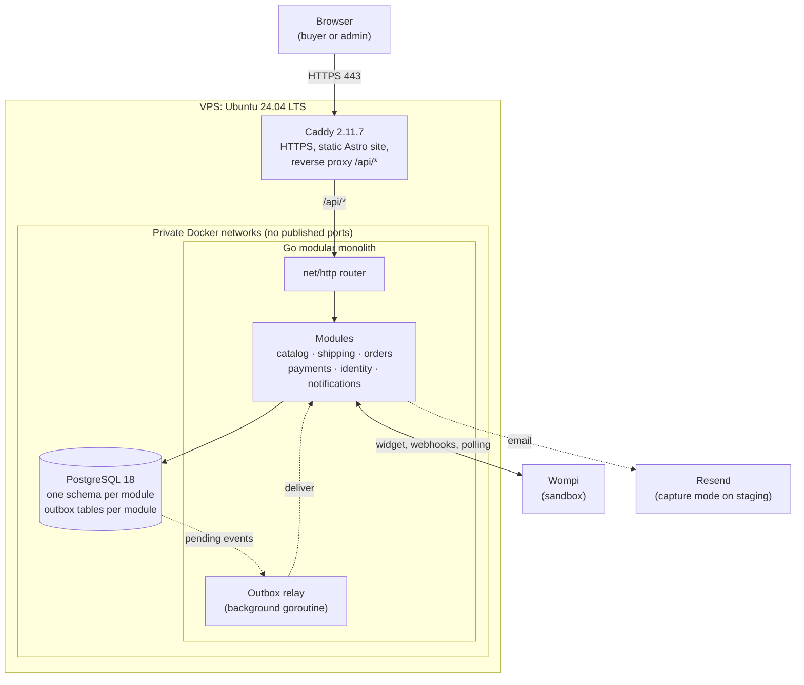
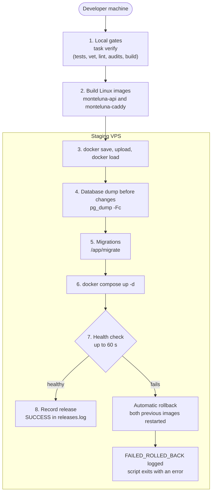
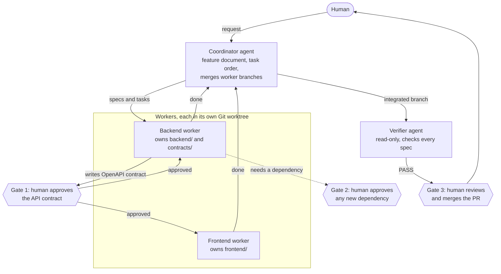
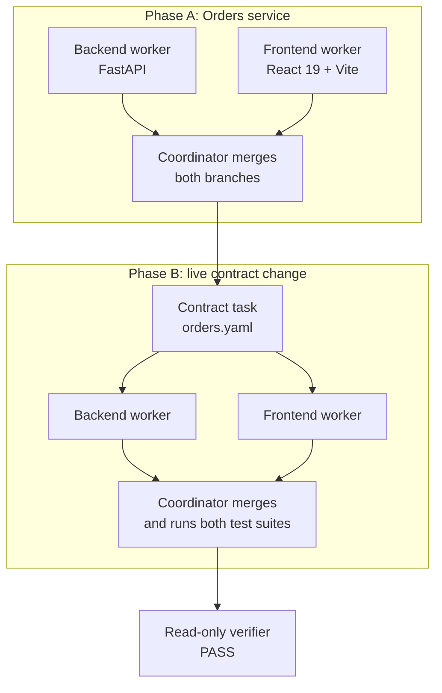
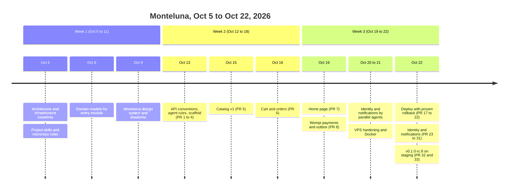
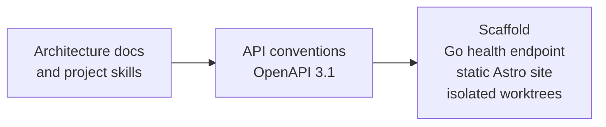
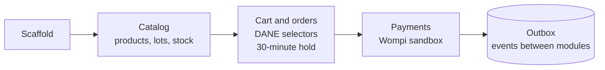
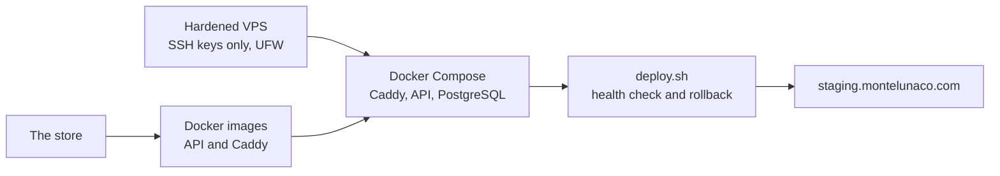
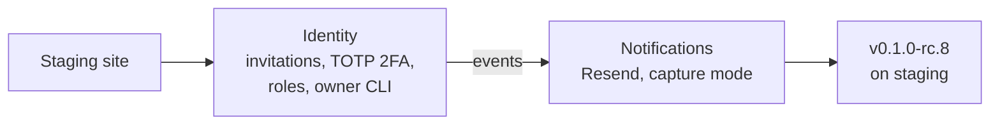

<div align="center">

[English](README.md) | [Español](README.es.md)

# Monteluna

**A fictional Colombian coffee & cacao store, built as an educational demo with AI agents working in parallel.**

Author: **Willy Cruz** ([@freedomCruz](https://github.com/freedomCruz))

[](LICENSE)
[](#educational-demo-and-disclaimer)
[](backend/)
[](frontend/)
[](frontend/)
[](docs/architecture/data-modeling.md)
[](deploy/caddy/)
[](deploy/compose.yaml)
[](#ai-agents-working-in-parallel)
[](https://staging.montelunaco.com)

</div>

---

### Contents

- [Educational demo and disclaimer](#educational-demo-and-disclaimer)
- [What is Monteluna?](#what-is-monteluna)
- [The architecture, explained for anyone](#the-architecture-explained-for-anyone)
- [Deployment and automatic rollback](#deployment-and-automatic-rollback)
- [AI agents working in parallel](#ai-agents-working-in-parallel)
- [Pilot 3: how we chose the pattern](#pilot-3-how-we-chose-the-pattern)
- [What we built, week by week](#what-we-built-week-by-week)
- [Repository layout](#repository-layout)
- [Run it locally](#run-it-locally)
- [Status and roadmap](#status-and-roadmap)
- [License](#license)

---

## Educational demo and disclaimer

> [!WARNING]
> **Monteluna is a fictional coffee and cacao store, built as an educational demo for live streams.**
>
> - **Not real products:** product names, farms, origins, tasting notes, prices, and stock are invented demo data. Nothing is for sale and nothing will ever be shipped.
> - **Sandbox payments only:** the staging site ([`staging.montelunaco.com`](https://staging.montelunaco.com)) uses the **Wompi sandbox**, so no real money moves. Never enter real card numbers or real personal data.
> - **No affiliation:** Monteluna is not related to any real brand, farm, or producer.

---

## What is Monteluna?

Monteluna is a complete online store used to show, in live streams, how a human can direct AI agents to build a realistic application with real engineering discipline: contracts first, tests first, reviews, and safe deployments.

### What a buyer sees
- **Catalog:** store page (`/tienda`), origin stories (`/origenes/<slug>`), and product pages (`/productos/<slug>`), all generated as static HTML.
- **Fresh prices and stock:** pages are static, but price, compare-at price, availability, and production (roast) date are fetched from the API in the browser, so they are always current without rebuilding the site.
- **Cart:** a slide-over panel and a cart page (`/carrito`).
- **Guest checkout (`/checkout`):** Colombian department and municipality selectors from the official DANE DIVIPOLA list, and a shipping quote by zone and weight band.
- **Payments:** the Wompi Web Checkout widget with a server-side integrity signature, signed webhooks, and a polling fallback (sandbox only).
- **Order tracking (`/pedido?token=...`):** order status steps, a 30-minute stock reservation countdown, and a snapshot of every purchased line.

### What runs behind it
One Go program (a *modular monolith*) with six modules: `catalog`, `shipping`, `orders`, `payments`, `identity`, and `notifications`.
- **Contract first:** every endpoint is described first in a hand-written OpenAPI 3.1 file in [`contracts/openapi/`](contracts/openapi/), and the code must match it.
- **Each module owns its data:** one PostgreSQL schema per module, with no foreign keys or joins across schemas.
- **Reliable side effects (transactional outbox):** when something happens in one module (for example, an order is paid), the event is saved in the same database transaction as the change, and a background routine in the same program delivers it. No message broker is needed.
- **Administrator security:** email invitations, password login with lockout and rate limiting, mandatory TOTP two-factor authentication with recovery codes, `owner` and `staff` roles, audited security events, and an SSH-only command to create the first owner.
- **Transactional email:** password reset and invitation emails through Resend, with signed delivery webhooks and bounce/complaint suppression. On staging, emails are only captured in memory, never sent.

---

## The architecture, explained for anyone

Think of Monteluna as a small coffee shop with a back office:

- **Caddy is the front door.** It handles the secure connection (HTTPS), hands out the printed menus (the static Astro pages) by itself, and sends any order or question (`/api/*`) to the back office.
- **The Go program is the back office.** Six departments work in the same room (catalog, shipping, orders, payments, identity, notifications). They talk through written forms (the OpenAPI contracts and Go interfaces), never by reaching into each other's desks.
- **PostgreSQL is the filing cabinet.** Each department has its own locked drawer (its schema). Orders cannot open the catalog drawer; it has to ask the catalog department.
- **The outbox is each department's "to notify" tray.** When payments confirms a payment, it files the receipt and drops a note in its tray in the same motion. A clerk empties the trays and tells the other departments. If the power goes out halfway, the note and the receipt are either both saved or both missing, so nothing gets lost.



### Why this architecture?

1. **One modular program instead of microservices.** Everything runs on one small VPS (4 shared vCPU, 8 GB RAM, 100 GB SSD; see [`infrastructure.md`](docs/architecture/infrastructure.md)). One program means one deploy, in-process calls, and fewer moving parts. Modules stay isolated (own schema, communication through Go interfaces and events), so any of them could be extracted later ([`system-architecture.md`](docs/architecture/system-architecture.md), section 5).
2. **Hexagonal layers inside each module.** `domain/` holds the business rules, `app/` the use cases, and `adapters/` the database, HTTP, and external services. Business rules never depend on the database or the web framework.
3. **Static first, with small interactive islands.** Pages are plain static HTML, good for speed and search engines. Only the interactive parts (cart, variant selectors, checkout) load React 19 code. No Node.js runs in production: Caddy serves the files with zstd and gzip compression.
4. **Only one door to the internet.** Only Caddy publishes ports (80 and 443). The API and PostgreSQL publish none. Docker documents that published ports bypass the UFW firewall, so not publishing them is the reliable way to keep them private.

---

## Deployment and automatic rollback

A release reaches the staging server with one script, [`deploy/deploy.sh`](deploy/deploy.sh), run from the developer's machine. There is no external CI service.



### Safeguards
1. **Local gates first.** The script refuses to continue unless the working tree is clean, the release tag exists, `HEAD` is exactly that tag, and every check passes (Go tests, vet, lint, govulncheck, npm audits, Astro check, Vitest, Playwright).
2. **Backup before migrating.** If a release is already running, the script dumps the database with `pg_dump -Fc` and stops if the dump is empty.
3. **Migrations that the previous version tolerates.** Migrations follow *expand, migrate, contract*, so the previous release can still run against the new schema after a rollback.
4. **Health check with automatic rollback.** The script checks `/api/v1/health` for up to 60 seconds. If it fails, it restarts the previous API and Caddy images, logs the failure, and exits with an error.
5. **Proven live.** On 2026-10-22, in a controlled drill, a watchdog stopped the containers of candidate `v0.1.0-rc.6` so its health check failed. The script restored `v0.1.0-rc.4` on its own and exited with an error, with catalog data intact ([`deploy-v1.md`](odd/tasks/deploy-v1.md), L37).
6. **Off-site backups: not active yet.** Today the only backups are the pre-deploy dumps. The daily backup (with upload to Cloudflare R2 through `restic`) is written but not installed, because the official restic release has reachable HTTP/2 vulnerabilities in `golang.org/x/net`. We prefer to wait for a fixed official release rather than install a patched build ([`deploy-v1.md`](odd/tasks/deploy-v1.md), L14–L16 and L38).

---

## AI agents working in parallel

Monteluna is the project used in live streams to show one idea: **several AI agents can build a feature at the same time without stepping on each other, if a human sets the rules and approves the key decisions.** The agents are Pi sessions, coordinated with Orca.



### The rules
These rules live in [`AGENTS.md`](AGENTS.md) (section 5) and the [`parallel-agents-orca`](.agents/skills/parallel-agents-orca/SKILL.md) skill:

1. **The contract comes first.** The backend worker writes the module's OpenAPI contract and the human approves it. Only then do backend and frontend work in parallel. The frontend uses types generated from the contract and mocks, so it never waits for backend code. A later contract change needs a new approval.
2. **Each path has one owner.** The backend worker writes only `backend/` and `contracts/`, the frontend worker only `frontend/`, and the coordinator owns `odd/`, `docs/`, and the root files. The verifier writes nothing.
3. **Each worker is isolated.** Every worker has its own Git worktree and branch, its own local database, and its own ports ([`scripts/setup-worktree.sh`](scripts/setup-worktree.sh)).
4. **Independent verification.** The coordinator merges the workers' branches into the feature branch, a read-only verifier checks every spec there, and only then does the coordinator open the pull request. The human reviews and merges.

Each feature has a document in [`odd/tasks/`](odd/tasks/) with its specs (quoting the user's exact words), its tasks, and a log of every decision and piece of evidence.

---

## Pilot 3: how we chose the pattern

Before building Monteluna, on **2026-10-05**, we ran a separate study with three pilots in Orca on Windows. All three built the same thing: an Orders service with a FastAPI backend and a React 19 + Vite frontend (phase A), followed by a live contract change (phase B).

| | Pilot 1 | Pilot 2 | **Pilot 3 (winner)** |
|---|---|---|---|
| **Setup** | Two different agent tools (Claude Code frontend, OpenCode backend) under Orca | Pi agents talking through a message bus, with file locks in Engram | One Pi coordinator and Pi workers under Orca's native task graph |
| **Score** | 5.97 / 10 | 8.00 / 10 | **8.55 / 10** |
| **Active time** | 21 min 39 s | **6 min 44 s** (fastest) | 11 min 19 s |
| **Total tokens** | 7.53 M | **6.52 M** (fewest) | 8.79 M |
| **Human interventions** | 3 | 0 | 0 |
| **Merge conflicts** | 0 | 0 | 0 |
| **Tests** | 14 | 11 | **20** |
| **Independent verification** | PASS | PASS | PASS |

> [!NOTE]
> Each pilot ran once, so the numbers show a trend, not a statistically solid ranking. In all three pilots, most tokens were cache reads.

### Why Pilot 3 won
- **No locks to manage.** Pilot 2 was the fastest, but it needed a custom message bus and file locks. Pilot 3 needed neither: every folder had exactly one owner.
- **The task graph sets the order.** Orca tasks with dependencies decided who works when: in phase B the contract task finished first, then backend and frontend worked in parallel, and the coordinator merged each branch only after the worker reported done.
- **Less friction than mixing tools.** Pilot 1 needed 3 human interventions (permission prompts and recreated terminals). Pilot 3 needed none.
- **Best balance.** Highest score and most tests, with no interventions. This pattern became the [`parallel-agents-orca`](.agents/skills/parallel-agents-orca/SKILL.md) skill used to build Monteluna.



---

## What we built, week by week

Dates come from the Git history of `main` (`git log --first-parent`), [`CHANGELOG.md`](CHANGELOG.md), and the feature documents in [`odd/tasks/`](odd/tasks/).



Each stage below adds pieces to the previous one.

#### Stage 1: foundations (Oct 5 to 13)
Architecture, data modeling, API conventions, design system, and the initial project skeleton (PRs #1 to #4).



#### Stage 2: the store (Oct 14 to 19)
Catalog, cart and orders, home page, and Wompi payments with the outbox (PRs #5 to #8). Catalog, cart and orders, and payments were built by parallel backend and frontend agents; the home page by a single agent.



#### Stage 3: on a real server (Oct 20 to 22)
VPS hardening, audited Docker Engine 29.9.2, Caddy rebuilt with Go 1.27.3, the deploy script with automatic rollback, and the staging site (PRs #17 to #22).



#### Stage 4: administrators and email (Oct 20 to 22)
Identity and notifications, built by parallel agents on Oct 20, merged as nine stacked PRs (#23 to #31), and released on staging as `v0.1.0-rc.8` (PRs #32 and #33).



> [!NOTE]
> **Interactive diagrams:** we plan interactive versions of these diagrams for live streams with [Archify](https://github.com/tt-a1i/archify) (an MIT-licensed AI agent skill that generates interactive HTML diagrams). It is not installed yet: like every dependency, it must pass an audit first.

---

## Repository layout

```text
monte-luna/
├── backend/          # Go modular monolith (cmd/api, cmd/migrate, cmd/admin, cmd/seed, internal/)
├── frontend/         # Astro static site with React 19 islands
├── contracts/        # OpenAPI 3.1 contracts and the DANE DIVIPOLA reference data
├── deploy/           # Production Compose, Caddy image, deploy script, backup scripts
├── scripts/          # Worktree setup, DIVIPOLA update, VPS hardening script
├── tests/            # Tests for repository scripts
├── docs/             # Architecture, domain rules, and the Monteluna design system
├── odd/tasks/        # One document per feature: specs, tasks, and log
├── .agents/skills/   # Instructions the AI agents read before working
├── AGENTS.md         # Rules for every agent working in this repository
├── compose.yaml      # Local PostgreSQL for development
├── Taskfile.yml      # Development tasks
├── CHANGELOG.md      # Release notes
├── LICENSE           # MIT license
└── NOTICE.md         # What the MIT license does not cover
```

---

## Run it locally

### Prerequisites
- **Go** (the backend's `go.mod` pins toolchain `go1.27.3`)
- **Node.js 24.21.0** (pinned in `.node-version`; for example with `fnm`)
- **Docker** with Docker Compose
- **[Task](https://taskfile.dev/)**
- `openssl` to generate local secrets

### Steps

1. **Clone and create your `.env`:**
   ```bash
   git clone https://github.com/freedomCruz/monte-luna.git
   cd monte-luna
   cp .env.example .env
   ```
   `.env` is never committed.

2. **Generate the two local secrets** and paste each value into `.env` (`TRACKING_TOKEN_SECRET` and `APP_ENCRYPTION_KEY`). The API refuses to start with the placeholders.
   ```bash
   openssl rand -base64 32
   ```

3. **Get your worktree's database name and ports** and copy `WORKTREE_DB`, `API_ADDR`, and `FRONTEND_PORT` into `.env`:
   ```bash
   task setup:preview
   ```

4. **Start PostgreSQL and create your database:**
   ```bash
   task dev:db:up
   task setup
   ```

5. **Create the tables and load the demo catalog:**
   ```bash
   task backend:migrate
   task backend:seed
   ```

6. **Start the API and the site** (in two terminals):
   ```bash
   task backend:dev
   task frontend:dev
   ```

7. **Run every check:**
   ```bash
   (cd frontend && npx playwright install chromium)   # once per machine
   task verify
   ```

Payments need your own Wompi **sandbox** keys in `.env`; see [`local-wompi-sandbox.md`](docs/development/local-wompi-sandbox.md). Emails stay in memory (`NOTIFICATIONS_EMAIL_SENDER=capture`).

---

## Status and roadmap

| Area | Status | Notes |
|---|---|---|
| Store (catalog, cart, checkout, tracking) | ✅ On staging | Static pages, prices and stock from the API |
| Payments | ✅ On staging | Wompi sandbox only |
| Deployment | ✅ On staging | Health check and automatic rollback, proven live |
| Identity and notifications (backend) | ✅ On staging | Release `v0.1.0-rc.8`; emails in capture mode |
| Admin screens (`/admin`) | ⏳ Planned | Deferred while their design is created; the first owner account exists |
| Order and payment emails | ⏳ Planned | "Order placed" and "order paid" |
| Off-site backups (R2) | ⏸️ Blocked | Waiting for an official `restic` release with the `golang.org/x/net` fixes |
| Production | ⏸️ Not planned | `montelunaco.com` is reserved; no real customers or payments |

---

## License

- **Everything in this repository:** [MIT](LICENSE), `Copyright (c) 2026 Willy Cruz`, except the items below.
- **Reserved, not MIT:** the Monteluna name and logo, the design system in [`docs/design/monteluna/`](docs/design/monteluna/), and the packaging images (`frontend/public/images/packaging-*.webp`). All rights reserved by Willy Cruz.
- **Stock photos:** `frontend/public/images/photo-*.jpg` come from a stock image bank and keep their original licenses; attribution is pending.
- Details in [`NOTICE.md`](NOTICE.md).

### Security

Please report vulnerabilities privately through [GitHub private vulnerability reporting](https://github.com/freedomCruz/monte-luna/security/advisories/new), not in public issues.
